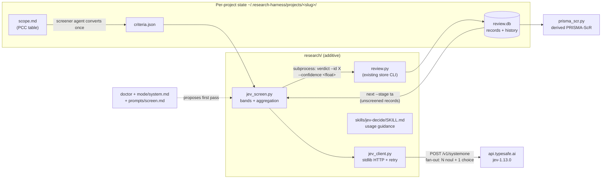
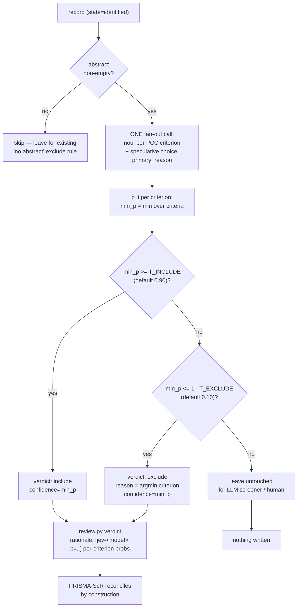

# Jev First-Pass Screening — Design Spec

- **Date:** 2026-09-19
- **Repo:** ~/Projects/research-harness (fork of can1357/oh-my-pi; additive layer under `research/`)
- **Status:** Approved by user in-session ("write the spec ... and start the queue")
- **Verification source:** live experiments 2026-09-19 (E1-E8) against `POST https://api.typesafe.ai/v1/systemone` — fan-out 8.65x faster / 4.29x cheaper than sequential (measured); toy calibration MAE 0.018 (n=10); wrong-but-confident case observed (E4). Report: `~/Projects/auto-learn-for-me/reports/2026-09/2026-09-19-typesafe-jev-first-hands.md`

## Problem

Title/abstract screening is the highest-volume judgment stage in the pipeline. Today every record is judged by the LLM screener agent — slow, token-heavy, and uncalibrated. TypeSafe Jev returns calibrated probabilities for typed questions in ~100ms server-side (~0.9s end-to-end from this machine) at $0.042/M input tokens (vendor price). It is a decision-only model: no prose, no reasoning traces, schema-closed outputs.

## Goal

Add an optional, cheap, calibrated FIRST PASS at title/abstract screening: Jev auto-decides only the clear cases (both bands), writes normal verdicts into the existing review store, and leaves every uncertain record untouched for the LLM screener agent. No key → zero behavior change.

## Non-goals (this round)

- Full-text stage screening (Jev handles T/A volume; FT stays binary and agent-run)
- Duplicate-pair judging, citation checking in the synthesizer, reranking auto-edges (follow-ups)
- Any UI/TUI work; any new demo assets (follow-up round if wanted)
- No `review.db` schema change, no `packages/`/lockfile/config.yml/agent-file changes

## System design

### Components and data flow



### Per-record decision flow



## Contracts

### criteria.json (screener agent produces it once per project from scope.md)

```json
{
  "population": "Text of the Population criterion that MUST be met",
  "concept": "Text of the Concept criterion that MUST be met",
  "context": "Text of the Context criterion that MUST be met"
}
```

- Keys are arbitrary non-empty strings (any criteria that must ALL be met); PCC naming is convention, not schema.
- Values are the full criterion text sent to the model. Exclusion-style criteria that must NOT hold belong as separate must-meet criteria only if phrased positively; otherwise the screener agent keeps them for the agent stage.

### jev_client.py (new, beside _http.py)

- `resolve_key(explicit=None) -> str|None`: `TYPESAFE_API_KEY` env, else `~/.research-harness/config.env` line `TYPESAFE_API_KEY=...`, else None.
- `fan_out(state, questions, api_key, model="jev-latest", timeout=90) -> dict`: one POST; returns the parsed `answers` dict; raises `JevUsageError` (400/422, message from body), `JevAuthError` (401/403), `JevError` (other).
- Retry: 429/500/502/503/504 and timeouts, ≤4 attempts, backoff 3/9/27s honoring numeric `Retry-After`, stderr notices only, stdout stays parseable (same rules as `_http.py`).
- `list_models(api_key) -> list`: for the doctor check.

### jev_screen.py (new)

- Reads `review.py next --stage ta --limit N` records (state=identified) via subprocess to the SAME interpreter, same repo scripts dir.
- Skips empty-abstract records (reported, not judged).
- ONE fan-out call per record: noul per criterion ("Does this record meet the <key> criterion: <text>?") + speculative Choice `primary_reason` over the criterion keys (consumed only on exclude).
- Bands (code, never the model): include if min_p >= T_INCLUDE; exclude if min_p <= 1 - T_EXCLUDE; else untouched.
- Writes verdicts ONLY through `review.py verdict --stage ta --confidence <min_p float>`; rationale prefix `[jev-<resolved-model> p=<min_p>]` + per-criterion probabilities; `--reason` = argmin criterion on exclude.
- Flags: `--project SLUG|DIR --criteria FILE [--limit N] [--dry-run] [--thresholds include=0.90,exclude=0.10] [--model jev-latest]`. Env: `JEV_MAX_RECORDS` (default 200/run budget), `TYPESAFE_API_KEY`.
- No key: stderr notice "Jev first-pass OFF (no TYPESAFE_API_KEY)" and exit 0.
- Never prints or stores the key; model pin: log the response's versioned `model` field per run.

### Integration surfaces (touch list)

- NEW: `research/skills/literature-search/scripts/jev_client.py`, `.../jev_screen.py`, `research/skills/jev-decide/SKILL.md`, tests `research/tests/test_jev_client.py`, `test_jev_screen.py`
- MODIFY: doctor (locate its implementation; add optional Jev check), `research/mode/system.md` (one paragraph: with key, /screen proposes Jev first-pass first), `research/prompts/screen.md` (first-pass step + criteria.json conversion instruction), `docs/ARCHITECTURE.md`, `README.md`
- NEVER: `packages/`, `crates/`, root package.json/lockfiles, `config.yml`, `~/.omp/agent/agents/{reviewer,reviewer-deep,tldr,pr}.md`

### Testing (repo non-negotiables)

- stdlib unittest, OFFLINE: the HTTP boundary is mocked (`unittest.mock` on `urllib.request.urlopen` inside jev_client); no test reads a real key or hits the network. A test that would hit the network must FAIL, not skip.
- jev_screen integration test uses a REAL temp project dir + REAL review.py (temp review.db) with fan_out monkeypatched — asserts verdicts, history rows, stats, untouched middle band, no-abstract skips.
- Named regression tests for the band logic: `test_regression_band_edges` (min_p exactly at T_INCLUDE / at 1-T_EXCLUDE / one step inside each band) and `test_regression_exclude_names_argmin_reason`. Mutation check required: reintroduce an off-by-one band bug (e.g. `>` vs `>=`), show the regression test FAILS, revert, show PASS.
- Suite gate: `bash research/tests/run.sh` — baseline 91 tests, 1 skipped, ~0.14s; must be green after every task.
- No `/Users/` absolute paths in shipped files (`grep -c "/Users/" research/ -r` = 0); no key material anywhere.

## Risks / mitigations

- Wrong-but-confident (observed live, E4): bands set wide (0.90/0.10); middle band escalates; every Jev verdict carries its probabilities in the rationale for audit.
- Calibration is domain-dependent: after the first real run, compare Jev's auto-verdicts against the screener agent's verdicts on the same records; report agreement per band (follow-up task, not in this round).
- Cost/quota: per-record fan-out ≈ 300-800 input tokens at list price (measured 420-799); `JEV_MAX_RECORDS` caps a run.
- Upstream rebase: everything additive under `research/`; zero fork-file touches.

## Out-of-scope deferred (candidate follow-ups)

1. Agreement report: Jev bands vs screener-agent verdicts on a real corpus
2. Duplicate-pair judging (entity-alignment pattern) in `dedupe`
3. Citation checking in the synthesizer (`citation_check` pattern)
4. Demo assets for the README (vhs MP4 + poster, per the repo's presentation standard)
